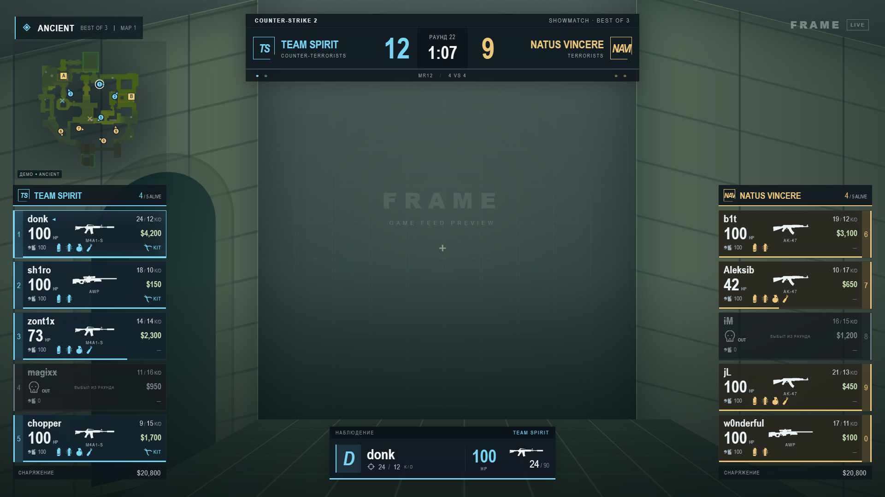
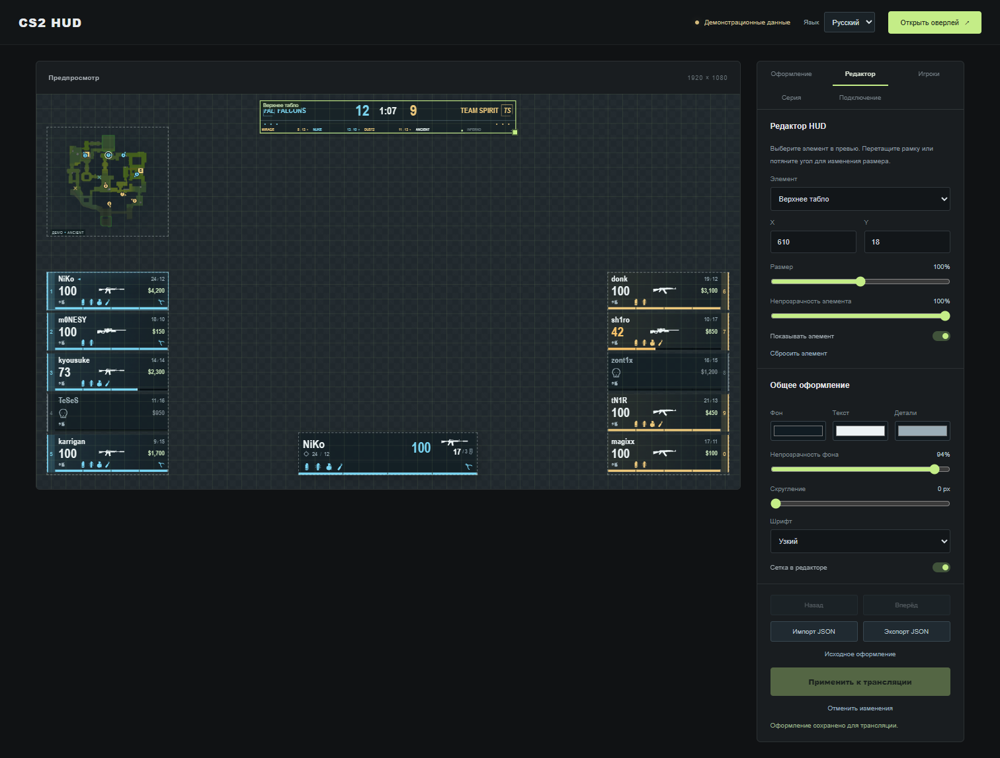

# CS2 Broadcast Hud

Локальный HUD для трансляций Counter-Strike 2. Готовое приложение для Windows включает сервер для OBS и локальный прозрачный оверлей; устанавливать Node.js, npm или Electron отдельно не нужно. Для запуска из исходников нужны Node.js и, для локального оверлея, Electron (инструкция ниже).



Текущий интерфейс на демонстрационных данных Falcons — Spirit: BO5, счёт по картам 1:2. Фон показан для предпросмотра; в OBS оверлей прозрачный.

## Короткая инструкция

Для готовой Windows-сборки запустите установщик **CS2 Broadcast Hud Setup**, затем приложение через ярлык. Либо запустите **CS2 Broadcast Hud Portable.exe** без установки. Приложение запускает сервер и локальный оверлей; для работы только с OBS скройте локальный HUD через **Ctrl+Shift+H**. Панель управления доступна через меню значка в трее. Полный выход через **Ctrl+Shift+Q** останавливает сервер, запущенный приложением.

Настройки и загруженные аватары приложения хранятся в `%APPDATA%\CS2 Broadcast Hud\`, в том числе при использовании portable-версии. Для переноса данных из исходников скопируйте `settings.json` и папку `uploads/avatars` в этот каталог при закрытом приложении. GSI-конфиг можно скачать по адресу `http://localhost:3199/gamestate_integration_broadcast.cfg` после запуска.

При запуске **из исходников** установите **Node.js LTS вместе с npm** по инструкции ниже. Если `node --version` и `npm --version` уже работают, переходите к настройке GSI.

1. **Установите GSI:** скопируйте `gamestate_integration_broadcast.cfg` в папку `game/csgo/cfg` установленной CS2 и полностью перезапустите игру. Для мини-карты используйте актуальный конфиг из проекта.
2. **Запустите HUD:** откройте готовое приложение или выполните `npm start` в папке исходников и откройте [панель управления](http://localhost:3199/). Если HUD уже работает в фоне, повторный запуск не нужен.
3. **Откройте матч:** подключитесь в CS2 наблюдателем/GOTV или запустите демку. Проверьте данные игроков в HUD, задайте названия, логотипы и стороны команд, примените оформление.
4. **Подготовьте CS2:** выберите **Полноэкранный в окне**, скройте игровой HUD и телеметрию по инструкции ниже. Выполните `snd_mute_losefocus 0` и `engine_no_focus_sleep 0`, чтобы сохранить звук и убрать задержку фонового режима при переключении в OBS.
5. **Настройте OBS:** добавьте **Захват окна → CS2**, а выше него — **Браузер** с URL `http://localhost:3199/overlay`, размером **1920 × 1080**, FPS **60**. Базовый холст OBS — **1920 × 1080**.
6. **Добавьте звук:** включите захват звука в источнике CS2 либо добавьте **Захват аудио приложения → cs2.exe**. Отключите **Аудио рабочего стола**, чтобы не было дубля; при необходимости добавьте микрофон.
7. **Проверьте запись:** закройте консоль и панель демки, запишите короткий фрагмент и проверьте звук и плавность после Alt+Tab. Игру оставляйте развёрнутой, HUD — запущенным. После обновлений HUD обновляйте кэш источника «Браузер» в OBS.

Подробные настройки, способы восстановления игрового интерфейса и решение проблем приведены ниже.

## Сборка приложения для Windows x64

Сборка выполняется на Windows с Node.js 22.12+ и npm. Интернет нужен для установки зависимостей и первой загрузки инструментов упаковки. Пользователям готового приложения эти инструменты не нужны.

```powershell
npm.cmd ci
npm.cmd test
npm.cmd run test:server
npm.cmd run test:overlay
npm.cmd run pack
```

Промежуточная сборка: `dist/win-unpacked/CS2 Broadcast Hud.exe`. Для её передачи нужна вся папка `win-unpacked`.

Для создания установщика и portable-файла:

```powershell
npm.cmd run dist
```

Готовые файлы в `dist`: `CS2 Broadcast Hud Setup <версия>.exe` и `CS2 Broadcast Hud Portable <версия>.exe`. Передайте пользователю один из них. Сборка включает Electron/Node.js, сервер, интерфейс, игровые ресурсы и GSI-конфиг. Пользовательские настройки и аватары в дистрибутив не включаются.

Перед выпуском проверьте сборку на Windows без Node.js: запуск, источник OBS, горячие клавиши, сохранение настроек и аватаров после перезапуска. Локальный оверлей и сервер запускаются вместе; скрытие окна оставляет сервер работающим.

## Установка Node.js и npm на Windows (для исходников)

1. Откройте [официальную страницу загрузки Node.js](https://nodejs.org/en/download) и выберите **LTS → Windows Installer (.msi)** под архитектуру вашего компьютера (обычно x64). Проект требует Node.js **20 или новее**; для новой установки используйте актуальную LTS-версию.
2. Запустите установщик. Оставьте включёнными компоненты **npm package manager** и **Add to PATH**. npm устанавливается вместе с Node.js, отдельно скачивать его не нужно.
3. Закройте и заново откройте терминал, затем проверьте установку:

   ```powershell
   node --version
   npm --version
   ```

   Обе команды должны вывести номера версий. Если команда не найдена, проверьте установку Node.js и компонент Add to PATH, затем откройте новый терминал.

4. Перейдите в папку проекта и запустите HUD:

   ```powershell
   cd C:\Users\You\Projects\cs_hood
   npm start
   ```

Если PowerShell блокирует `npm.ps1` сообщением о запрете выполнения сценариев, используйте `npm.cmd --version` и `npm.cmd start` вместо команд `npm`. Менять политику выполнения PowerShell для запуска HUD не требуется.

Для обычного браузерного HUD с `npm start` команда `npm install` не нужна. Для прозрачного окна поверх игры выполните `npm install` один раз: оно установит Electron. [Официальная инструкция npm по установке Node.js и npm](https://docs.npmjs.com/downloading-and-installing-node-js-and-npm/).

## Запуск

```powershell
npm start
```

- Панель управления: http://localhost:3199
- Прозрачный оверлей: http://localhost:3199/overlay

Если `npm start` сообщает, что порт 3199 занят, проверьте панель управления: возможно, HUD уже запущен в фоне и повторный запуск не нужен.

## Прозрачное окно HUD поверх CS2

Этот режим позволяет видеть наш HUD прямо поверх игры и переключать наблюдаемых игроков клавишами или мышью в CS2. Оверлей не получает фокус клавиатуры и пропускает нажатия мыши в игру.

### Установка и запуск

Для этого режима используйте **Node.js 22.12 или новее**, лучше актуальную LTS-версию. В папке проекта один раз установите зависимости:

```powershell
npm install
```

Затем запускайте:

```powershell
npm run overlay
```

Либо откройте двойным щелчком **`start-overlay.cmd`** в папке проекта. Если PowerShell блокирует `npm.ps1`, используйте `npm.cmd install` и `npm.cmd run overlay`. При первом запуске Electron может дополнительно скачать свой исполняемый файл — дождитесь завершения загрузки.

Оверлей сам запускает сервер HUD, если порт 3199 свободен. Если HUD уже работает через `npm start`, окно подключается к нему. GSI-конфиг, оформление и история серии используются те же, что и в OBS.

### Управление

| Действие | Горячая клавиша |
| --- | --- |
| Показать / скрыть оверлей | **Ctrl+Shift+H** |
| Обновить HUD без кэша | **Ctrl+Shift+R** |
| Перенести на следующий монитор | **Ctrl+Shift+M** |
| Закрыть оверлей | **Ctrl+Shift+Q** |

Значок **H** появляется в системном трее Windows (при необходимости раскройте скрытые значки рядом с часами). Правой кнопкой по нему можно выбрать монитор, открыть панель управления, скрыть HUD или выйти. Если горячая клавиша занята другим приложением, используйте меню в трее.

Окно открывается на основном мониторе, покрывает его целиком и автоматически масштабирует HUD с сохранением пропорций 16:9. При выборе другого монитора или изменении его разрешения размер окна пересчитывается. Пока оверлей показан, он находится поверх остальных окон; скрывайте его горячей клавишей, когда работаете вне игры.

В CS2 выберите **Полноэкранный в окне**. В эксклюзивном полноэкранном режиме внешний оверлей может быть не виден. Оставляйте CS2 активной для переключения игроков: окно HUD не управляет игрой и не внедряется в её процесс.

### Как сочетать с OBS

- При **Захвате окна CS2** используйте отдельный источник **Браузер → `http://localhost:3199/overlay`** в OBS. Прозрачное окно служит вам для наблюдения, браузерный источник — для оформления трансляции.
- При **Захвате всего экрана**, на котором уже виден оверлей, отключите отдельный браузерный HUD в OBS, чтобы не рисовать его дважды.
- Скрытие локального окна через Ctrl+Shift+H не скрывает отдельный браузерный источник HUD в OBS.

При закрытии оверлея автоматически останавливается только сервер, запущенный самим оверлеем. Сервер, который был запущен отдельно через `npm start`, продолжает работать.

## Настройка OBS Studio

### 1. Сцена и разрешение

1. Запустите HUD и CS2 на одном компьютере. Подключитесь наблюдателем/GOTV или откройте демозапись.
2. В OBS в блоке **Сцены** нажмите **＋** и создайте сцену `CS2`.
3. Откройте **Настройки → Видео**: базовое разрешение **1920 × 1080**, выходное разрешение **1920 × 1080**, FPS **60**. Если компьютер не справляется, можно уменьшить выходное разрешение или FPS, оставив базовый холст 1920 × 1080.

### 2. Изображение CS2

1. В CS2 выберите режим отображения **Полноэкранный в окне**.
2. В OBS в блоке **Источники** нажмите **＋ → Захват окна**, назовите источник `CS2` и выберите **Counter-Strike 2 / cs2.exe**.
3. Если окно отсутствует в списке, разверните игру, затем закройте и снова откройте свойства источника. Во время эфира оставляйте игру развёрнутой; переключайтесь в OBS через Alt+Tab.
4. Выделите источник и нажмите **Ctrl+F**, чтобы вписать изображение в холст. Для кадра без полос используйте в CS2 соотношение сторон **16:9**.

Можно использовать **Захват игры**, если он работает в вашей конфигурации. Если изображение чёрное или CS2 не захватывается, вернитесь к **Захвату окна**. Запасной вариант — **Захват экрана**, но в эфир тогда попадёт всё, что появляется на выбранном мониторе. [Справка OBS по захвату игр](https://obsproject.com/kb/game-capture-troubleshooting).

### 3. Оверлей HUD

1. Добавьте **Источники → ＋ → Браузер**, назовите источник `HUD`.
2. Укажите параметры:

   | Параметр                                     | Значение                        |
   | -------------------------------------------- | ------------------------------- |
   | Локальный файл                               | Выключено                       |
   | URL                                          | `http://localhost:3199/overlay` |
   | Ширина                                       | `1920`                          |
   | Высота                                       | `1080`                          |
   | Использовать пользовательскую частоту кадров | Включено                        |
   | FPS                                          | `60`                            |

3. Расположите `HUD` **выше источника CS2** в списке: верхние источники рисуются поверх нижних.
4. Выделите HUD и нажмите **Ctrl+F**. После настройки заблокируйте оба источника значками замка, чтобы случайно их не сдвинуть.

В OBS нужен адрес **с `/overlay`**. Главная страница `http://localhost:3199/` — панель управления с непрозрачным предпросмотром. Фон страницы оверлея прозрачный; хромакей не нужен. После обновления кода нажмите **Обновить кэш текущей страницы** в свойствах источника `HUD`. [Описание источника «Браузер» в OBS](https://obsproject.com/kb/browser-source).

### 4. Звук игры и комментарий

HUD выводит графику. Звук матча поступает в OBS из CS2 отдельно.

1. В свойствах **Захвата окна** включите **Захват звука (БЕТА)**, если этот пункт доступен.
2. Если такого пункта нет, добавьте **Источники → ＋ → Захват аудио приложения (БЕТА)**, назовите его `Звук CS2` и выберите **cs2.exe**. Используйте один способ захвата звука игры, чтобы не получить дубль.
3. В **Настройки → Аудио** отключите **Аудио рабочего стола**, если звук CS2 уже захватывается отдельно. Так игра не будет звучать дважды, а системные звуки не попадут в эфир через общий источник.
4. Для комментария добавьте **Захват входного аудиопотока** с нужным микрофоном. Если микрофон уже добавлен глобально в настройках OBS, второй экземпляр не нужен.
5. В **Микшере аудио** проверьте движение шкал игры и микрофона, отсутствие отключённого звука и перегрузки в красной зоне. Сбалансируйте громкость так, чтобы речь была разборчива поверх игры.

[Инструкция OBS по захвату звука приложений](https://obsproject.com/kb/application-audio-capture-guide).

### Важно: звук и FPS при переключении в OBS

Перед эфиром откройте консоль **CS2** и выполните обе команды:

```text
snd_mute_losefocus 0
engine_no_focus_sleep 0
```

- `snd_mute_losefocus 0` — сохраняет звук игры при потере фокуса, например при переключении в OBS.
- `engine_no_focus_sleep 0` — убирает дополнительную задержку фонового режима, из-за которой FPS может падать примерно до 40. Команда не гарантирует конкретную частоту кадров: она также зависит от нагрузки компьютера.

Используйте режим CS2 **Полноэкранный в окне** и переключайтесь через **Alt+Tab**, оставляя окно игры развёрнутым. Полностью свёрнутая игра может перестать отрисовываться даже с этими командами.

Для повторного применения после запуска CS2 можно сохранить команды в отдельный файл `broadcast_view.cfg` в папке `game/csgo/cfg` и выполнять в консоли `exec broadcast_view`. Это обычный конфиг команд, отдельный от `gamestate_integration_broadcast.cfg`.

Проверьте короткой записью: переключитесь из CS2 в OBS и убедитесь, что звук продолжается, а изображение остаётся плавным. Для возврата стандартного поведения выполните `snd_mute_losefocus 1` и `engine_no_focus_sleep 20`. [Переменные CS2 и их стандартные значения](https://github.com/ArmynC/ArminC-CS2-Cvars/blob/main/cvars/cvarlist.md).

### 5. Запись и трансляция

Перед эфиром сделайте короткую **пробную запись** и просмотрите её со звуком. Для прямой трансляции откройте **Настройки → Трансляция**, подключите свою платформу, затем нажмите **Начать трансляцию**. HUD должен оставаться запущенным всё время эфира.

## Чистый кадр CS2: скрыть игровой HUD и телеметрию

Эти настройки выполняются **в CS2 наблюдателя**, а не в OBS. Они скрывают элементы изображения и не отключают передачу данных GSI нашему HUD.

### Скрыть встроенный HUD

Включите **Настройки → Игра → Включить консоль разработчика → Да**. Во время просмотра матча или демозаписи откройте консоль клавишей **Ё / ~** и выполните:

```text
cl_draw_only_deathnotices 1
cl_drawhud_force_radar -1
cl_drawhud_force_teamid_overhead -1
cl_drawhud_force_deathnotices 1
```

Основной игровой интерфейс будет скрыт, включая встроенный радар и подписи над игроками. Прицел и лента убийств останутся: ленту убийств наш HUD пока не заменяет. Если её тоже нужно убрать, используйте `cl_drawhud_force_deathnotices -1`.

Эти команды не требуют `sv_cheats`. Команда `cl_drawhud 0` для обычной настройки эфира не нужна: она относится к защищённым командам и полностью отключает игровой HUD, включая полезные элементы. Описание флагов и поведения команд: [дамп консольных переменных CS2](https://github.com/ArmynC/ArminC-CS2-Cvars/blob/main/cvars/cvarlist.md).

### Убрать FPS, пинг и сетевые графики

В **Настройки → Игра → Телеметрия** выберите **Никогда** для отображения времени кадра/FPS, пинга и сетевых проблем; отключите подробную сетевую статистику и графики, если они включены. Пункты могут немного отличаться между версиями игры. [Справка Steam о телеметрии Source 2](https://help.steampowered.com/en/faqs/view/5E6F-5B36-5485-F6B9).

То же через консоль, включая дополнительные графики:

```text
cl_hud_telemetry_frametime_show 0
cl_hud_telemetry_ping_show 0
cl_hud_telemetry_net_misdelivery_show 0
cl_hud_telemetry_net_detailed 0
cl_hud_telemetry_net_quality_graph_show 0
cl_hud_telemetry_serverrecvmargin_graph_show 0
cl_showfps 0
r_show_build_info 0
```

Последние две команды убирают отдельный счётчик FPS и служебную строку сборки. Если текущая версия CS2 сообщает `Unknown command`, пропустите соответствующий пункт и настройте доступные показатели через меню телеметрии.

После команд закройте консоль, меню и панель управления демозаписью. Панель демки обычно переключается **Shift+F2**. Если остались счётчики или уведомления от Steam, Discord, NVIDIA/AMD либо другого приложения, отключите их оверлеи отдельно: команды CS2 ими не управляют.

### Вернуть интерфейс после эфира

```text
cl_draw_only_deathnotices 0
cl_drawhud_force_radar 0
cl_drawhud_force_teamid_overhead 0
cl_drawhud_force_deathnotices 0
r_show_build_info 1
```

Для возврата телеметрии выберите нужные режимы в **Настройки → Игра → Телеметрия**. Если вы дополнительно меняли `cl_drawhud`, верните `cl_drawhud 1` там, где команда разрешена. Перед отключением источника HUD в OBS сначала верните интерфейс игры, если он нужен зрителям.

### Проверка перед выходом в эфир

- В OBS видны игра и один комплект карточек/табло, без встроенного HUD и телеметрии поверх них.
- В панели CS2 Broadcast Hud указан статус подключения CS2, имена и счёт соответствуют матчу, мини-карта получает координаты.
- Названия и логотипы команд заданы вручную, стороны CT/T выбраны правильно.
- Звук игры слышен один раз, микрофон работает, пробная запись воспроизводится без эха.
- При переключении из CS2 в OBS звук не пропадает и FPS не проседает из-за фонового режима; команды `snd_mute_losefocus 0` и `engine_no_focus_sleep 0` применены.
- Консоль, меню игры, панель демки и сторонние уведомления закрыты.

## Данные CS2

Скопируйте `gamestate_integration_broadcast.cfg` в папку `.../Counter-Strike Global Offensive/game/csgo/cfg/`, затем перезапустите CS2. Приложение должно работать на том же компьютере, что и CS2. Войдите наблюдателем или через GOTV: полные сведения обо всех игроках поступают только в режиме наблюдения. HTTP-сервер слушает только локальный интерфейс `127.0.0.1:3199`.

CS2 отправляет POST-запросы на `/gsi`; приложение рассылает обновления браузерам через SSE. Используемая структура GSI: [документация Counter-Strike-HUD](https://github.com/Counter-Strike-HUD/gsi-documentation/blob/main/STRUCTURE.md), [Valve Developer Community](https://developer.valvesoftware.com/wiki/Counter-Strike:_Global_Offensive_Game_State_Integration).

До первого сигнала включён встроенный демопример **Falcons — Team Spirit** на Ancient. Falcons: NiKo, m0NESY, kyousuke, TeSeS, karrigan; Spirit: donk, sh1ro, zont1x, tN1R, magixx. В демопримере используется BO5 со счётом по картам **1:2 (Falcons : Spirit)**: Mirage 8:13, Nuke 13:10, Dust2 11:13; текущая карта — Ancient, возможная пятая — Inferno. Счёт, статистика и позиции иллюстративные — это не запись реального матча. [Состав Falcons](https://www.hltv.org/team/11283/falcons), [состав Spirit](https://liquipedia.net/counterstrike/Team_Spirit). При подключении CS2 демоуправление блокируется. Через 10 секунд без GSI панель показывает потерю сигнала и сохраняет последний кадр. Блок управления тестовым эфиром в панели отсутствует.

## Мини-карта

Слева сверху выводится план текущей карты и координаты всех игроков из GSI. Цвета соответствуют командам, номера — карточкам игроков; стрелки показывают направление взгляда, кресты — погибших, белое кольцо — наблюдаемого игрока. При наличии данных о положении C4 отображается бомба. На многоуровневых картах этаж выбирается по высоте наблюдаемого игрока, а игроки другого этажа отображаются приглушённо со стрелкой высоты.

Маркеры плавно перемещаются между пакетами GSI с небольшой задержкой сглаживания (80–180 мс), а направление взгляда поворачивается по кратчайшему пути. При смене карты/раунда, длительном разрыве обновлений и больших скачках координат позиции сбрасываются сразу, чтобы перемотка демки и возрождение не выглядели как движение через всю карту. План карты не пересоздаётся при каждом обновлении HUD.

Поддерживаются Dust2, Mirage, Inferno, Nuke, Ancient, Anubis, Overpass, Train, Vertigo, Cache, Ancient Night, Office и Italy. Планы и калибровка сохранены локально в `public/assets/radars`, [источник](public/assets/radars/SOURCE.md). Обновление: `node scripts/download-radars.mjs`. Для неподдерживаемой карты отображается сообщение вместо неверного плана.

В GSI-конфиге должны быть включены `allplayers_position` и `player_position`. После обновления конфига полностью перезапустите CS2. Без координат HUD показывает план и статус ожидания. Мини-карту можно отключить во вкладке «Редактор»: выберите «Мини-карта» и выключите «Показывать элемент», затем примените макет.

## Админская панель и язык

В верхней части панели доступен выбор **Русский / English**. Язык применяется сразу, сохраняется в этом браузере и не меняет язык графики трансляции или введённые названия команд. Переведены вкладки, настройки, инструкции подключения, состояния и сообщения проверки результатов. Переключение языка сохраняет несохранённые значения форм.

Панель содержит предпросмотр, настройки команд и элементов HUD, аватарки игроков, серию карт и подключение. Тестовый эфир с кнопками, рекламные подписи, версия, декоративный фон предпросмотра и неиспользуемые поля турнира убраны.

## Оформление

В панели задаются названия команд, цвета и логотипы PNG/JPG/WebP до 500 КБ. Настройки сохраняются в `settings.json` после нажатия «Применить» и передаются всем открытым оверлеям. **Команда 1** и **Команда 2** — постоянные участники матча; их названия, логотипы, цвета и результаты серии сохраняют принадлежность команде.

В эфире **CT всегда слева, T — справа**. Смена сторон определяется автоматически по ID игроков: вместе с составами переставляются названия, логотипы, цвета, счёт и история карт. Переход одного игрока не вызывает перестановку команд. Кнопка **Сменить стороны CT / T** служит для ручной коррекции привязки: после нажатия примените оформление. При первоначальном подключении или перезапуске сервера посреди матча проверьте сторону команды 1 по строке под этой кнопкой и при необходимости исправьте её. Автоматическое отслеживание работает в текущем сеансе сервера, включая смену половин, овертаймы и переход между картами с теми же игроками.

## Визуальный редактор оформления

Откройте вкладку **Редактор / Editor** в админской панели. На предпросмотре появятся рамки пяти элементов: верхнего табло, левого и правого состава, мини-карты и карточки текущего игрока.

1. Нажмите на рамку в предпросмотре или выберите элемент в списке.
2. Перетащите рамку для перемещения. Потяните квадратный маркер в её углу для изменения размера. Координаты X/Y задаются в пикселях холста **1920 × 1080**; размер можно менять от **50% до 150%**.
3. Для точной подгонки используйте поля координат. Когда рамка выделена, стрелки клавиатуры сдвигают элемент на **1 px**, Shift + стрелка — на **10 px**.
4. Настройте непрозрачность элемента или отключите его переключателем **Показывать элемент**. Видимость мини-карты и карточки текущего игрока теперь настраивается здесь. Цвета команд по-прежнему задаются во вкладке «Оформление».
5. В разделе **Общее оформление** выберите цвет фона, текста и деталей, прозрачность фона, скругление и один из трёх шрифтов. Сетка и рамки служат только для редактирования.
6. Нажмите **Применить к трансляции**. До этого изменения остаются черновиком только в вашем предпросмотре. После сохранения они передаются всем открытым оверлеям OBS и desktop-окнам через сервер.

**Назад / Вперёд** отменяют и повторяют действия. **Сбросить элемент** возвращает исходное положение и размер выбранного блока; **Исходное оформление** сбрасывает весь макет. Эти действия также остаются черновиком до применения. **Отменить изменения** возвращает последнее сохранённое оформление.

**Экспорт JSON** скачивает текущий макет в `cs2-hud-layout.json`; **Импорт JSON** загружает его в предпросмотр для проверки перед применением. В файл входят расположение, масштаб, видимость и общая тема; названия команд, логотипы, аватарки и результаты матчей не меняются. Макет хранится в поле `layout` файла `settings.json` и восстанавливается после перезапуска. Координаты ограничены границами холста. Для BO1 скрытые по формату строки серии остаются скрытыми независимо от темы.



## Аватарки игроков

1. Подключите CS2 и откройте матч или демозапись, чтобы в HUD появился реальный состав.
2. В админской панели откройте вкладку **Игроки / Players**.
3. Нажмите **Загрузить / Upload** у нужного игрока и выберите PNG, JPG или WebP до **5 МБ**. Фото автоматически обрезается по центру до квадрата **256 × 256** и сохраняется в WebP.
4. Изображение сразу появляется в боковой карточке и плашке текущего игрока. Кнопки **Заменить / Replace** и **Удалить / Remove** позволяют изменить или убрать аватарку; нажимать «Применить» не требуется.

Привязка выполняется по **Steam ID**, а не по нику, месту в списке или CT/T. Фото сохраняется после смены сторон, изменения ника и перезапуска HUD. Сохранённые игроки, которых сейчас нет в составе, остаются доступны в этой вкладке. У игрока без загруженного фото боковая карточка и центральная плашка отображаются без портрета; буквенная заглушка не выводится.

В демонстрационном режиме показаны тестовые игроки с отдельными ID: их аватарки не переносятся на реальных игроков. Для настройки матча сначала дождитесь данных CS2.

Файлы хранятся локально в `uploads/avatars/`, привязки — в `settings.json`; при переносе на другой компьютер копируйте и папку, и настройки. При удалении аватарки снимается её привязка к игроку, исходный сохранённый файл остаётся в локальной папке. Изображения загружаются через локальный сервер HUD и доступны браузерному источнику OBS и desktop-оверлею.

## История карт серии BO1 / BO3 / BO5

Верхнее табло занимает 700 × 90 пикселей при холсте 1920 × 1080. Под счётом находится компактная строка высотой 18 пикселей с картами и итоговыми результатами. Победителя сыгранной карты показывает логотип команды рядом с названием и счётом карты. Используется логотип, загруженный в настройках команды; если его нет, выводится короткое обозначение команды. Цветовая подсветка и стрелки победителя убраны. Полное название победителя доступно в подсказке при наведении на результат в браузере. Текущая карта выделена, будущие показаны приглушённо. Индикаторы побед находятся под счётом текущей карты; победитель серии появляется в той же строке истории, без отдельного баннера.

1. Откройте вкладку **Серия** в панели управления.
2. Выберите **BO1 — одна карта**, **BO3 — до 2 побед** или **BO5 — до 3 побед**, затем номер текущей карты.
3. Укажите названия карт. Для завершённых карт введите итоговые раунды **команды 1 и команды 2** из вкладки «Оформление», включая овертаймы, и отметьте **✓**. Над колонками отображаются их названия.
4. Нажмите **Сохранить серию**. Например, Dust2 13:8 и Mirage 10:13 дадут общий счёт 1:1; для следующей карты выберите номер 3.

Победитель определяется по счёту каждой завершённой карты. Ничьи, пропуски в истории завершённых карт и результаты после досрочной победы в серии не сохраняются. При смене CT/T результаты в эфире переставляются вместе с командами; сохранённые результаты относятся к командам 1 и 2. При переходе на другую карту обновите номер текущей карты вручную. Для новой серии очистите предыдущие результаты и выберите карту 1.

История сохраняется в `settings.json` и восстанавливается после перезапуска HUD. В этой версии результаты серии вводятся **вручную**: GSI обновляет состояние текущей карты, а записи предыдущих карт оператор сохраняет отдельно. При уменьшении формата лишние карты удаляются из сохранённой серии: в BO1 остаётся только карта 1. В BO1 победитель единственной сыгранной карты становится победителем матча. В оверлее BO1 отображается только основное табло: точки побед и строка истории карт скрыты.

## Патроны игроков

Только в плашке текущего игрока показаны патроны текущего магазина и резерв: например, **24 / 3**. Для магазинного оружия в актуальной CS2 второе число — запасные магазины; для оружия с поштучной перезарядкой отображается запас патронов с другой иконкой. Значения берутся из GSI без деления резерва на ёмкость магазина. В боковых карточках счётчика патронов нет. У ножа, гранат, C4 и погибших счётчик скрывается. Подписи HP, названия оружия и K/D в карточках не выводятся; остаются числовые значения и иконки.

Это соответствует [обновлению боеприпасов Valve от 18 марта 2026](https://www.counter-strike.net/newsentry/532126482488623360). Старые демозаписи могут передавать резерв в старых единицах; HUD отображает полученное значение без попытки угадать формат.

## Графические ресурсы

Над боковыми карточками нет повторных названий команд; названия и логотипы находятся в верхнем табло. Общая стоимость снаряжения под составами не выводится.

Карточки содержат HP, броню, шлем, основное/активное оружие, гранаты, деньги, kills/deaths и defuse kit. У наблюдаемого игрока дополнительно отображаются патроны, гранаты и defuse kit при наличии. Подписи «Наблюдение» и название команды в его плашке не выводятся; верхнее табло не содержит строки турнира и текстового счёта серии — остаются счёт карты, таймер, индикаторы побед и сами карты. Оружие, ножи, гранаты и снаряжение используют 102 SVG-иконки из файлов CS2: [источник и версия](public/assets/equipment/SOURCE.md). Иконки сохранены локально и встроены в `public/app.js`, без внешних запросов во время эфира. Обновление набора: `node scripts/download-icons.mjs` (требуется интернет). Портреты игроков загружаются вручную во вкладке «Игроки»; видеокамеры в эту версию не входят. Если логотип команды не загружен, используется её короткое обозначение. Для Spirit в демопример включён [логотип команды и сведения об источнике](public/assets/teams/SOURCE.md). Демоимена и статистика иллюстративные.

Шрифты Manrope и Barlow Condensed загружаются из Google Fonts; без интернета используются системные шрифты. Для постоянного офлайн-эфира можно разместить шрифты локально.

## Проверка

```powershell
npm test
npm run test:server
npm run test:overlay
```

Тесты проверяют преобразование GSI, снаряжение, гранаты, счёт, проекцию координат радара и выбор этажа. `test:server` временно запускает отдельный сервер на порту 32199, основной HUD останавливать не требуется. Проверяются HTTP, изображения карт, SSE, приём координат через GSI и блокировка демокоманд в реальном эфире.

`test:overlay` требует установленного Electron, использует отдельный порт 32198 и скрытое нативное окно. Проверяет прозрачность, отсутствие фокуса, масштабирование HUD, изоляцию браузера и управление сервером; на Windows дополнительно проверяет системные флаги пропуска мыши и запрета активации окна. Профиль теста хранится в игнорируемой папке `node_modules/.cache`.

## Структура проекта

| Путь | Назначение |
| --- | --- |
| `server.mjs`, `lib.mjs`, `avatars.mjs` | Сервер, обработка GSI, демонстрационные данные и загрузка аватарок |
| `public/` | Интерфейс HUD и админской панели: HTML, CSS и модули JavaScript |
| `public/assets/` | Ресурсы интерфейса: `equipment/` — иконки, `radars/` — планы карт, `teams/` — логотипы и сведения об источниках |
| `desktop/` | Прозрачное окно Electron, его иконка и проверка запуска |
| `docs/images/` | Актуальные иллюстрации README: `hud-preview.png` и `layout-editor.png` |
| `docs/images/archive/` | Старые скриншоты и снимки отдельных элементов; могут отличаться от текущего интерфейса |
| `scripts/` | Загрузка ресурсов и проверка сервера |
| `test/` | Автоматические тесты |
| `uploads/` | Загруженные аватарки; создаются локально и не входят в Git |
| `settings.json`, `settings.*.json`, `*.log` | Локальные настройки, их резервные копии и журналы; не входят в Git |
| `gamestate_integration_broadcast.cfg` | Конфиг GSI для папки CS2 `game/csgo/cfg` |
| `start-overlay.cmd` | Запуск прозрачного окна HUD в Windows |

Изображения для документации хранятся в `docs/images/`, ресурсы самого HUD — в `public/assets/`, иконка окна — в `desktop/`. При обновлении интерфейса заменяйте `docs/images/hud-preview.png`, чтобы скриншот в начале README оставался актуальным.


### Гранаты и траектории на мини-карте

В режиме наблюдателя мини-карта показывает осколочные, световые, дымовые, зажигательные и ложные гранаты. След строится по фактическим координатам из последовательных GSI-пакетов и окрашен в цвет команды бросившего игрока. Это пройденный путь, а не прогноз места падения. При исчезновении гранаты или начале следующего раунда след очищается; после срабатывания дыма его след скрывается, значок остаётся до исчезновения объекта из GSI.

Обновите установленный в `game/csgo/cfg` файл `gamestate_integration_broadcast.cfg` версией из проекта (добавлен параметр `"allgrenades" "1"`) и перезапустите CS2. Конфиг также доступен кнопкой скачивания во вкладке «Подключение». Данные гранат нужны из режима наблюдателя/GOTV или демозаписи.
